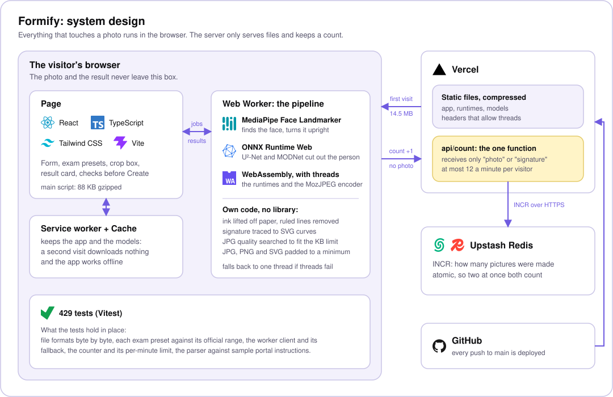

<p align="center">
  
</p>

<h1 align="center">Formify</h1>

<p align="center">
  Turns a selfie and a photo of your signature into files that meet an exam form's exact rules.<br>
  Everything runs in the browser: the photo never leaves your device.
</p>

<p align="center">
  <a href="https://formify-five-rust.vercel.app/"><b>Open the app</b></a>
</p>

## The problem

Exam and job application forms in India ask for a photo and a signature with strict rules:
"3.5 x 4.5 cm, white background, JPG, between 10 and 200 KB". A file that is one kilobyte
over, or a few pixels off, is refused by the upload page. People solve this with a chain of
websites (one to remove the background, one to resize, one to compress), each of which
receives their photo.

Formify does the whole job in one place and uploads nothing.

## What it does

- **Photo.** Finds the face, turns a sideways photo upright, removes the background and
  paints the colour the form asks for, crops to the right shape with the head placed as a
  passport-style photo expects, and saves at the exact pixel size.
- **Signature.** Lifts the ink off a photo of paper, removes the ruled lines of a notebook
  page, straightens it, and saves it as a clean picture. It can also be traced into an SVG,
  which stays sharp at any size.
- **File size, exactly.** Searches for the JPG quality that lands under the form's maximum,
  and pads the file when the form also sets a minimum. JPG, PNG and (for signatures) SVG.
- **Exam presets.** Pick an exam and the numbers are filled in, each with a link to the
  official page it was read from.
- **Paste the instructions.** Paste a form's own wording ("JPG, 200 x 230 px, 20 to 50 KB")
  and the fields are filled from it.
- **Says no early.** A request that cannot be met (say, 1000 x 1000 px in 5 KB) is marked in
  red and blocked before any work is done, with a setting that would work.
- **Checks the result.** A checklist shows what the form asks for beside what the file
  actually has, and warns about things a form would reject: a tilted head, a face in shadow,
  a blurred photo.
- **Works offline and installs** like an app after the first visit.

## System design

<p align="center">
  
</p>

There is no backend for the pictures. The server does two things: it serves static files,
and one small function counts how many pictures have been made. That function is sent only
the word "photo" or "signature".

### How a photo is made

1. **Load and turn upright.** The picture is decoded, and MediaPipe Face Landmarker looks for
   a face at each of the four rotations, so a sideways phone photo is fixed without asking.
2. **Find the person.** U²-Net (4.6 MB) marks which pixels belong to the person. With
   "Finer hair edges" on, MODNet (26 MB, downloaded only then) supplies a soft edge for hair.
3. **Composite.** The person is placed on the background colour the form asks for.
4. **Crop.** The face landmarks set the crop so the head fills the share of the frame a
   passport-style photo expects. The crop can also be moved by hand.
5. **Resize and encode.** The picture is brought to the exact pixel size, then MozJPEG
   (compiled to WebAssembly) is run in a binary search over quality until the file fits the
   KB limit.
6. **Validate.** The finished file is read back and checked against every rule.

### How a signature is made

1. **Find the ink.** The paper's uneven lighting is evened out and the ink separated from it.
2. **Remove ruled lines.** The lines of a notebook page are found, even when the page is
   curved, and taken out without breaking the strokes that cross them.
3. **Straighten and crop** to the signature itself.
4. **Paint** the ink on a clean background at the size asked for, or
5. **Trace to SVG.** The outline is followed (marching squares), simplified
   (Ramer-Douglas-Peucker) and turned into smooth Bézier curves.

The signature steps use no model and no library: they are written for this project.

### Why it is built this way

| Decision | Reason |
| --- | --- |
| Everything in the browser | The photo is an identity document. Nothing to upload means nothing to leak, and no server to pay for as use grows. |
| The pipeline runs in a Web Worker | The page stays responsive while the models run. The picture is handed over without copying, and Cancel stops the worker at once. |
| Models warm up when a photo is picked | The download and start-up happen while the user is still setting the crop, so Create feels quick. |
| WebAssembly with threads, and a fallback | Threads need two response headers. If they are missing, or a thread fails to start, the worker restarts on one thread instead of failing. |
| Service worker with three caching rules | Built files have a hash in their name, so they are cached for good; models are served from cache and refreshed behind; everything else asks the network first. |
| WebGPU was measured and left out | The default model does not run on it, the first run is slower, and the runtime is twice the size. The numbers are in [MODELS.md](MODELS.md). |
| A smaller face model | Google's face bundle carries a network for facial expressions that this app never runs. Rebuilding the bundle without it saves about 1 MB. |
| The counter sits behind an interface | The counting logic is tested against an in-memory store; in production it talks to Redis with one atomic `INCR`, limited to 12 a minute per visitor. |

## Numbers

Measured on the live site and a production build, on a desktop with Chrome.

| What | Value |
| --- | --- |
| Main script | 88 KB gzipped |
| Download before the first photo (runtimes and models, compressed) | 14.5 MB, once |
| Download on a later visit | nothing: served from the cache |
| A photo, once the models are warm | about 1.7 s |
| A signature | about 0.3 s |
| Tests | 429 |

## Exams built in

| Exam | Photo | Signature | Read from |
| --- | --- | --- | --- |
| GATE 2026 | 3.5 x 4.5 cm, 5 to 600 KB | 480 x 150 px, 3 to 300 KB | [IIT Guwahati](https://gate2026.iitg.ac.in/photograph-and-signature.html) |
| JEE Main 2027 | passport size, 10 to 200 KB | 10 to 100 KB | [NTA information bulletin](https://cdnbbsr.s3waas.gov.in/s3f8e59f4b2fe7c5705bf878bbd494ccdf/uploads/2026/10/202610241890224107.pdf) |
| NEET UG 2026 | passport size, 10 to 200 KB | 10 to 100 KB | [NTA information bulletin](https://cdnbbsr.s3waas.gov.in/s37bc1ec1d9c3426357e69acd5bf320061/uploads/2026/02/202602081576322299.pdf) |
| SSC CGL 2026 | none: the form takes it live | 6 x 2 cm, 10 to 20 KB | [SSC notice, paragraph 9.6](https://ssc.gov.in/api/attachment/uploads/masterData/NoticeBoards/Notice_of_adv_cgl_2025.pdf?mode=light) |
| UPSC | 350 to 1000 px a side, 20 to 300 KB | 350 to 1000 px a side, 20 to 300 KB | [UPSC registration FAQ](https://upsconline.gov.in/upsc/OTRP/candidate/faq.php) |
| IBPS and SBI | 200 x 230 px, 20 to 50 KB | 140 x 60 px, 10 to 20 KB | not confirmed, see below |

All were checked on 14 November 2026. Any other form works too: type its numbers, or paste
its instructions.

## Limits

- **Rules change every year.** Each preset shows its source and the date it was checked.
  Read your own form's notice before uploading.
- **IBPS and SBI numbers are not confirmed.** They were seen only as excerpts of official
  notices, which could not be opened. The app says so when that preset is chosen.
- **No passport or visa photos.** Passport guidelines forbid photos altered by software, and
  this app replaces the background.
- **One signature per picture.** Some UPSC pages ask for three in one picture.
- **Thumb impressions and handwritten declarations** are not made.
- **A very small KB limit in PNG may be impossible**, because PNG cannot trade quality for
  size. The app blocks such a request before any work is done.

## Tech stack

| Part | Tools |
| --- | --- |
| Page | React 19, TypeScript, Tailwind CSS 4, Vite 8 |
| Models | ONNX Runtime Web (U²-Net, MODNet), MediaPipe Tasks Vision (Face Landmarker) |
| Encoding | MozJPEG through `@jsquash/jpeg`; PNG chunks and SVG written by hand |
| Platform | Web Workers, WebAssembly threads, Service Worker and Cache API, OffscreenCanvas |
| Hosting | Vercel (static files and one function), Upstash Redis |
| Tests | Vitest |

## Run it

```bash
npm install
```

```bash
npm run dev
```

The first run downloads one model (26 MB) and checks it against its checksum. In
development the counter is served from memory, so no database is needed.

```bash
npm test
```

```bash
npm run build
```

## Deploy

The site is static: `npm run build` writes everything to `dist/`. Any static host will do,
with one requirement: every response must carry these two headers, which let the model
runtime use threads.

```
Cross-Origin-Opener-Policy: same-origin
Cross-Origin-Embedder-Policy: require-corp
```

Without them the app still works, on one thread and more slowly.

`vercel.json` sets them for Vercel, along with long caching for the built files and no
caching for the service worker (so a new release is noticed). To deploy there, import the
repository in Vercel and accept the detected settings.

### The counter

`api/count.ts` is the site's one server function. It needs a Redis database with a REST
interface. On Vercel: Storage, then add Upstash for Redis and connect it to the project,
which sets `KV_REST_API_URL` and `KV_REST_API_TOKEN` (`UPSTASH_REDIS_REST_URL` and
`UPSTASH_REDIS_REST_TOKEN` are read as well). Until then the function answers 503 and the
page shows no count. Only the kind of picture is sent; the visitor's address is used,
hashed, for one minute to stop a script inflating the number.

## Layout

| Path | What lives here |
| --- | --- |
| `src/App.tsx`, `src/*.tsx` | The page: form, exam picker, crop box, result card, counter |
| `src/pipeline/` | Photo pipeline: load, orient, landmarks, segment, composite, crop, encode, validate |
| `src/signature/` | Signature pipeline: ink, ruled lines, straighten, paint, trace to SVG |
| `src/spec/` | The form's rules: units, exam presets, instruction parser, what is possible |
| `src/worker/` | The Web Worker, its message protocol, and the client that talks to it |
| `src/counter/`, `api/count.ts` | The counter: logic, browser client, and the Vercel function |
| `public/sw.js` | The service worker |
| `public/models/` | Model files and `models.json` |
| `scripts/` | Copies the runtimes, fetches and slims models, draws the icons |
| `MODELS.md` | Source, licence and checksum of every model, and the WebGPU measurements |

## Credits

- Models: [U²-Net](https://github.com/xuebinqin/U-2-Net), [MODNet](https://github.com/ZHKKKe/MODNet)
  and [MediaPipe Face Landmarker](https://ai.google.dev/edge/mediapipe/solutions/vision/face_landmarker),
  all Apache-2.0. Details are in [MODELS.md](MODELS.md).
- Logos in the system design diagram are from [Simple Icons](https://simpleicons.org/) and
  belong to their owners.

## Licence

The code is under the [MIT licence](LICENSE). The model files keep their own licences
(Apache-2.0), listed in [MODELS.md](MODELS.md).

## Author

Developed by [Kunal Khairnar](https://github.com/Kunal-Khairnar-05).
